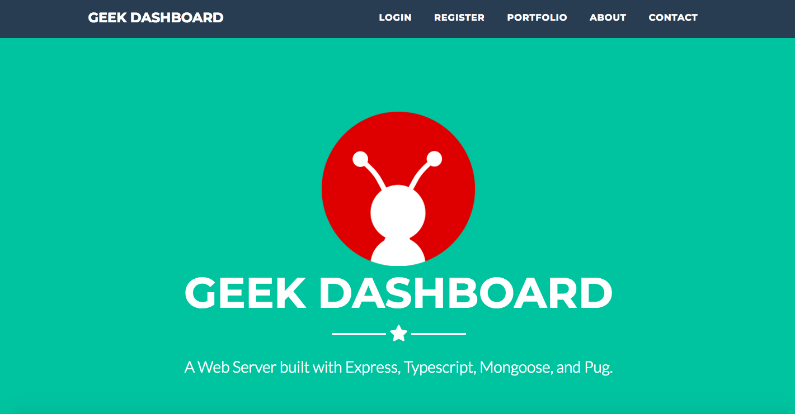
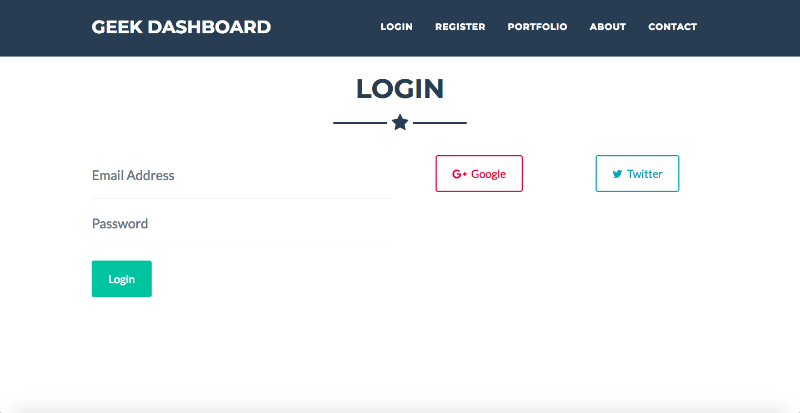
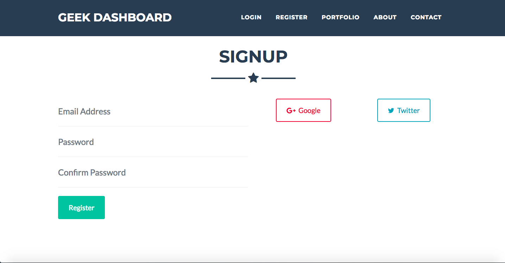
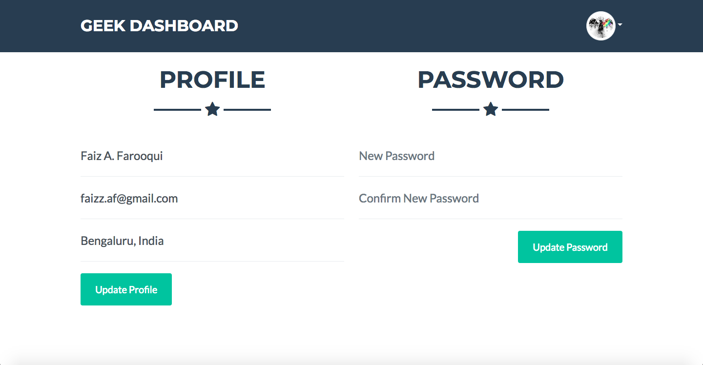
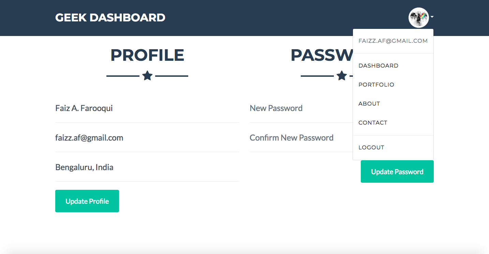
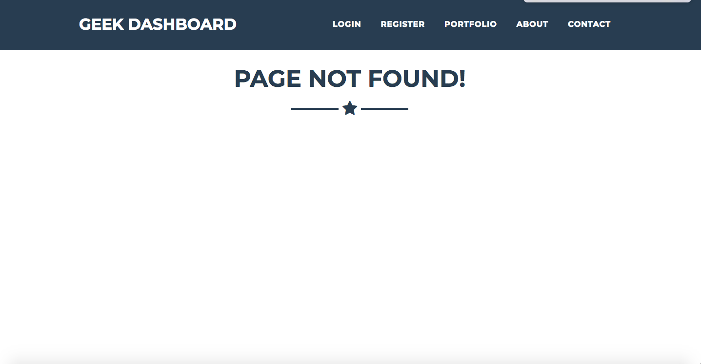
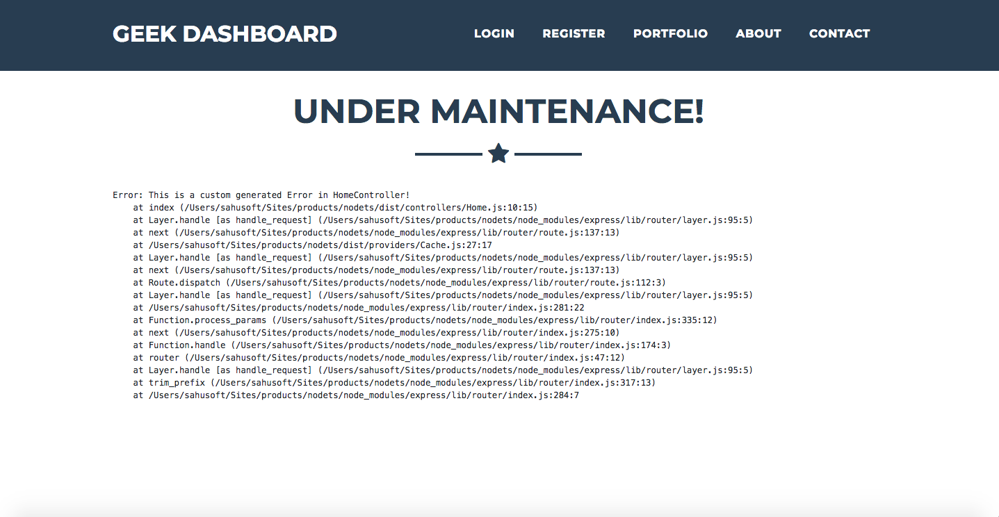

```
Hey There! 🙌 
🤾 that ⭐️ button if you like this boilerplate. 
```


A boilerplate for [Node.js](https://nodejs.org/en) App.

* This boilerplate is built using [Express.js](https://expressjs.com/) web framework, and is using [Typescript Lang](https://www.typescriptlang.org/) for writing the app's logic. 
* It uses Node's [Cluster API](https://nodejs.org/api/cluster.html), this helps us to take advantage of multi-core systems & to handle the load.
* For storing custom constant configurations within the `process.env` - [DotEnv](https://github.com/motdotla/dotenv) package is used.
* For Database - Repo contains the use of [Mongoose](https://mongoosejs.com/) (ie. [MongoDB](https://www.mongodb.com/) object modeling for [Node.js](https://nodejs.org/en/)).
* For Cache - Repo contains the use of [memory-cache](https://github.com/ptarjan/node-cache#readme) (ie. A simple in-memory cache for node.js).
* For Routing - Repo contains the use of [express-router](https://expressjs.com/en/guide/routing.html) & have distributed Routes into two files ie. Web Routes & API Routes. 
* For Route Auth Middleware - Web routes are configured with [CSRF Token](https://github.com/krakenjs/lusca) while the API routes are configured with [JSON Web Token](https://github.com/auth0/express-jwt).
* For Strategies Auth - Repo contains the use of the [Passport.js](https://github.com/jaredhanson/passport). Passport.js is compatible with Express.js and is authentication middleware for Node.js.
* For Logging - Repo uses custom Log class built in middlewares folder, and it creates logs file by date & removes the log files after 'X' days (You can define that 'X' in the `.env` file).
* For Handling Exception - Repo contains two classes ie. `Handler` & `NativeEvent`.
* To Log - use `Log.info('Your message should go here!')`. Other options for logging are `Log.warn`, `Log.error` & `Log.custom`.
* For views - Repo contains the use of [PUG](https://github.com/pugjs/pug) template engine.
* For background queues - Repo contains the use of [Kue](https://github.com/Automattic/kue). For more details, please review the [Queue](https://github.com/faizahmedfarooqui/nodets/blob/master/src/providers/Queue.ts) class.
* [BetterQueue](https://github.com/Saiop68/better-queue) - Distributed rate limiter and job queue for Node.js with Redis-backed state, cross-process priority and crash recovery.

# Contents

* [Global Requisites](#global-requisites)
* [App Structure](#app-structure)
* [Install, Configure & Run](#install-configure--run)
* [List of Routes](#list-of-routes)
* [Screens](#screens)

# Global Requisites

* node (>= 10.5.0)
* tsc (>= 3.0.1)
* typescript (>= 3.0.1)
* mongoose (>= 3.6.2)
* redis

# App Structure

> _Note: I am mentioning only files/folders which you need to configure if required_

```bash
├── dist
├── public
├── src
│   ├── controllers
│   │   ├── Api
│   │   │   ├── Auth
│   │   │   │   ├── Login.ts
│   │   │   │   ├── RefreshToken.ts
│   │   │   │   └── Register.ts
│   │   │   └── Home.ts
│   │   ├── Auth
│   │   │   ├── Login.ts
│   │   │   ├── Logout.ts
│   │   │   ├── Register.ts
│   │   │   └── Social.ts
│   │   ├── Account.ts
│   │   └── Home.ts
│   ├── exception
│   │   ├── Handler.ts
│   │   └── NativeEvent.ts
│   ├── interfaces
│   │   ├── models
│   │   │   └── user.ts
│   │   └── vendors
│   │        ├── index.ts
│   │        ├── INext.ts
│   │        ├── IRequest.ts
│   │        └── IResponse.ts
│   ├── middlewares
│   │   ├── CORS.ts
│   │   ├── CsrfToken.ts
│   │   ├── Http.ts
│   │   ├── Kernel.ts
│   │   ├── Log.ts
│   │   ├── Statics.ts
│   │   ├── StatusMonitor.ts
│   │   └── View.ts
│   ├── models
│   │   └── User.ts
│   ├── providers
│   │   ├── App.ts
│   │   ├── Cache.ts
│   │   ├── Database.ts
│   │   ├── Express.ts
│   │   ├── Locals.ts
│   │   ├── Passport.ts
│   │   ├── Queue.ts
│   │   └── Routes.ts
│   ├── routes
│   │   ├── Api.ts
│   │   └── Web.ts
│   ├── services
│   │   └── strategies
│   │        ├── Google.ts
│   │        ├── Local.ts
│   │        └── Twitter.ts
│   └── index.ts
├── views
│   ├── includes
│   ├── modals
│   ├── pages
│   ├── partials
│   ├── static
│   │   ├── css/*.css
│   │   └── js/*.js
│   └── layout.pug
├── .env
├── .gitignore
├── nodemon.json
├── package.json
├── README.md
├── tsconfig.json
└── tslint.json
```

# Install, Configure & Run

Below mentioned are the steps to install, configure & run in your platform/distributions.

```bash
# Clone the repo.
git clone https://github.com/GeekyAnts/express-typescript.git;

# Goto the cloned project folder.
cd nodets;
```

```bash
# Without Docker

# Note: It is assumed here that you have MongoDB running in the background and that you have created the database.

# Install NPM dependencies.
# Note: You can review the list of dependencies from the below link.
# https://github.com/faizahmedfarooqui/nodets/network/dependencies
npm install;

# Edit your DotEnv file using any editor of your choice.
# Please Note: You should add all the configurations details
# or else default values will be used!
vim .env;

# Run the app
npm run dev;
```

```bash
# With Docker

# Note: It is assumed here that you have Docker running in the background.

# Run the app in docker as a foreground process
docker-compose up

# Run the app in docker as a background process
docker-compose up -d
```


# List of Routes

```sh
# Web Routes:

+--------+-------------------------+
  Method | URI
+--------+-------------------------+
  GET    | /
  GET    | /signup
  POST   | /signup
  GET    | /login
  POST   | /login
  GET    | /logout
  GET    | /account
  GET    | /auth/google
  GET    | /auth/google/callback
  GET    | /auth/twitter
  GET    | /auth/twitter/callback
  GET    | /status-monitor
+--------+-------------------------+

# API Routes:

+--------+-------------------------+
  Method | URI
+--------+-------------------------+
  POST   | /api
  POST   | /api/auth/login
  POST   | /api/auth/register
  POST   | /api/auth/refresh-token
+--------+-------------------------+
```

# Screens

### Home / Landing Page


> Note: This page has sub-sections, like about-us, contact-us & portfolio

### LogIn Page


> Note: LogIn with Providers

### SignUp Page


> Note: SignUp with Providers

### Dashboard Page



### With Dropdown Menu



### Page Not Found Page


> Note: In case the requested URI does not exist, app shows this page

### Under Maintenance Page


> Note: In case an error is generated, so instead of plain errors we can show the under maintenance page.

## About GeekyAnts

This boilerplate is maintained by [GeekyAnts](https://geekyants.com?utm_source=github&utm_medium=opensource&utm_campaign=express-typescript),
a product development studio specializing in:

- [Backend Engineering](https://geekyants.com/engineering/backend?utm_source=github&utm_medium=opensource&utm_campaign=express-typescript) -
  Scalable server-side solutions
- [Node.js Development](https://geekyants.com/hire-nodejs-developers?utm_source=github&utm_medium=opensource&utm_campaign=express-typescript) -
  Expert Node.js developers for hire
- [Full Stack Development](https://geekyants.com/service/full-stack-app-development-services?utm_source=github&utm_medium=opensource&utm_campaign=express-typescript) -
  End-to-end application development

### Enterprise Solutions

Need a custom backend architecture? Our
[backend engineering team](https://geekyants.com/engineering/backend?utm_source=github&utm_medium=opensource&utm_campaign=express-typescript)
can help you build:

- Microservices architecture
- API development and integration
- Database design and optimization

[Schedule a consultation](https://geekyants.com/hire?utm_source=github&utm_medium=opensource&utm_campaign=express-typescript)

---

Built by [GeekyAnts](https://geekyants.com?utm_source=github&utm_medium=opensource&utm_campaign=express-typescript) |
[Node.js Development Services](https://geekyants.com/hire-nodejs-developers?utm_source=github&utm_medium=opensource&utm_campaign=express-typescript)
